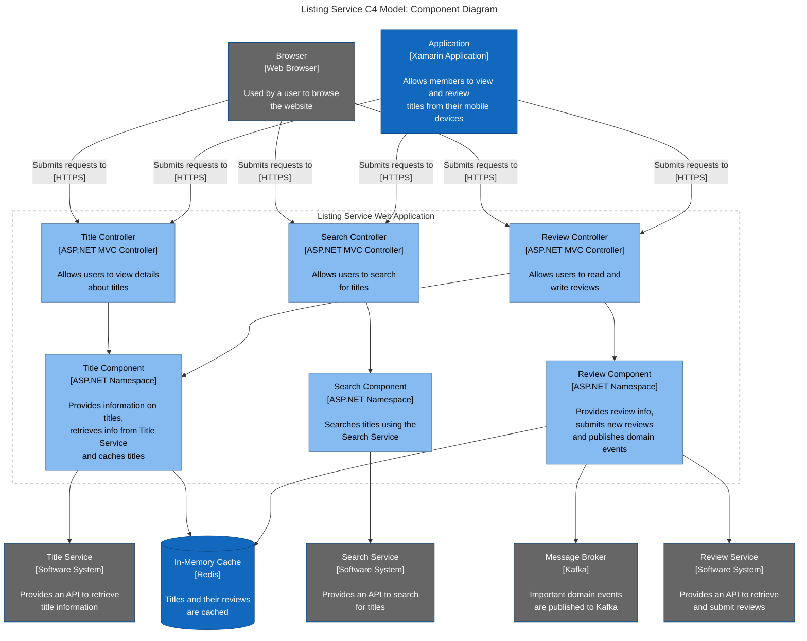

```mermaid
---
title: "Loan Eligibility Decision Flow"
---
flowchart TD
    Start([Applicant Applies]) --> CheckCredit{"Credit Score > 700?"}
    CheckCredit -- Yes --> CheckIncome{"Debt-to-Income < 40%?"}
    CheckCredit -- No --> ManualReview[Flag for Manual Underwriting]
    CheckIncome -- Yes --> AutoApprove[Automatically Approve Loan]
    CheckIncome -- No --> ManualReview
    ManualReview --> SeniorReview{"Senior Underwriter Decision"}
    SeniorReview -- Approved --> SendOffer[Issue Loan Offer]
    SeniorReview -- Denied --> SendRejection[Send Adverse Action Notice]
    AutoApprove --> SendOffer